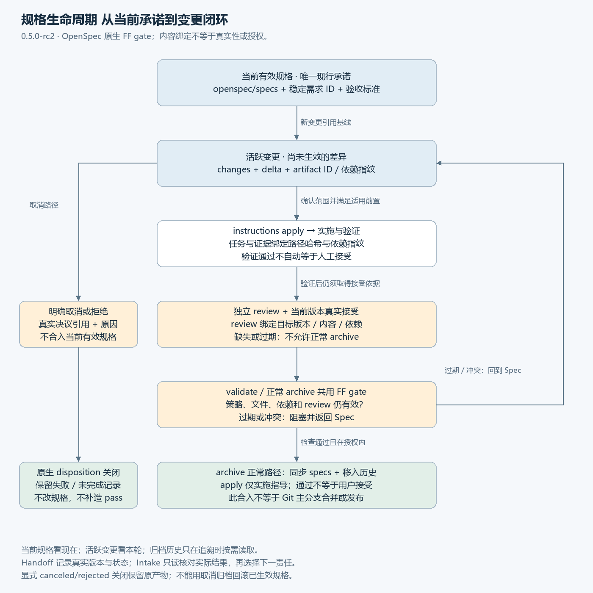
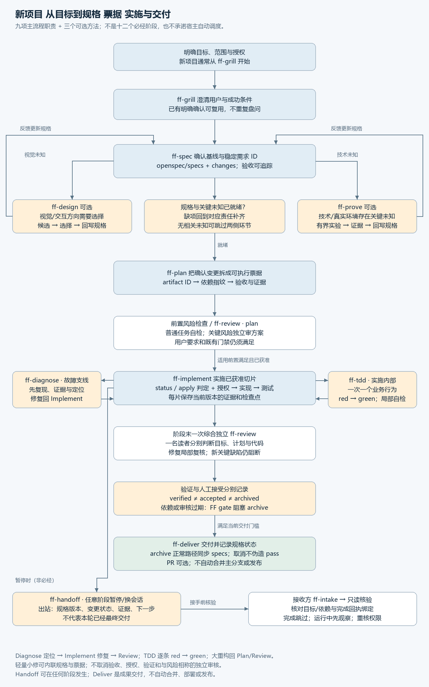
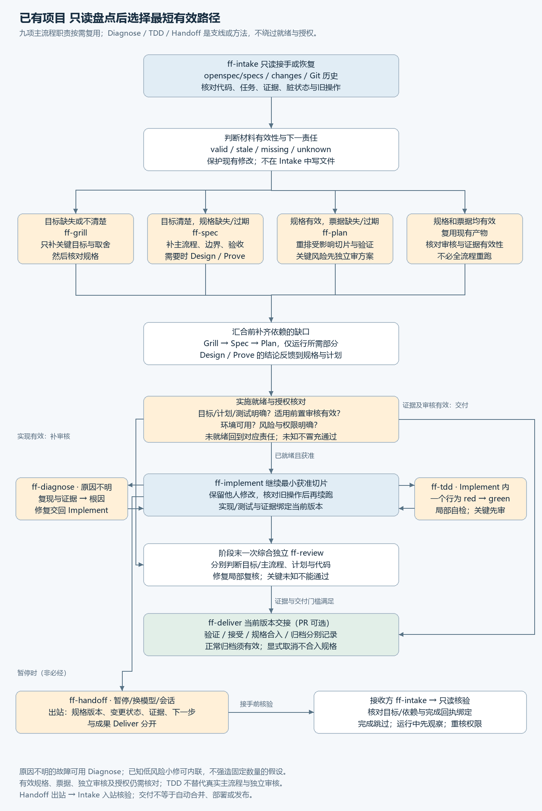
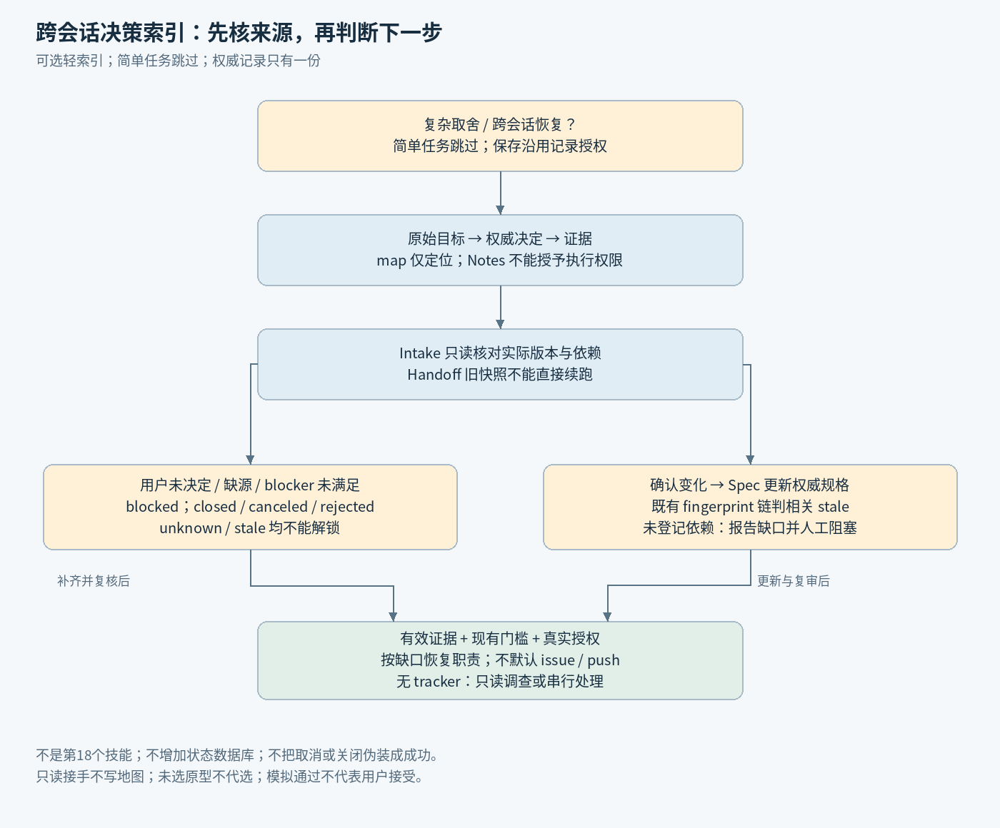

# ForgeFlow 十七技能中文使用手册

版本：0.9.3-dual-host.1 双宿主安装候选（工作分支，未发布） · 2026-10-19

本候选增加 Codex/Claude 同项目共存安装；两端共享运行时，安装就绪不代表模型实际调用。操作见 [安装与首次使用](https://github.com/chyhelloworld/ForgeFlowSkill/blob/work/dual-host-coexistence/docs/user/install.md)（本地文件 `docs/user/install.md`）。Goal 契约沿用 0.9.2-goal.2，在五个现有职责中条件接入 Codex `/goal`，详见 [Goal 使用指南](https://github.com/chyhelloworld/ForgeFlowSkill/blob/work/goal-memory-bookshelf/docs/user/codex-goal.md)（本地文件 `docs/user/codex-goal.md`）。只复用当前规格、唯一计划与原回执，不自动同步原生目标或增加调度器。原生状态、技术证据与约定真人接受分别报告；普通 FF 不要求设置目标。以下历史验证段落仍只覆盖各自原冻结版本，不代表本候选验收。

这份手册说明如何把新想法或已有半成品推进成可验证、可审查、可交接的功能切片。普通任务默认：目标/规格/计划有效 → 执行者自检与相关确定性检查 → 阶段末一次综合独立审查 → 问题局部复核 → 交付。核心替换、主要用户路径、数据迁移、安全边界、验收口径变化须提前独立审方案，风险不按行数/文件数判断；用户额外审核要求和项目既有门禁仍优先。阶段是可独立验收的功能切片，不逐小任务审，也不能拖到整个项目结束。图示与正文均按此频率说明职责；具体门禁以项目有效 policy 为准。

本版本是技能说明与 OpenSpec FF 适配的候选包。0.8 已完成 Windows 原生构建、项目安装和 CLI 操作；Codex 上下文发现了 17 项技能，但完整宿主调用受 setup refresh 错误阻塞。0.9 的本机验证、未测项和证据见 iterations/0.9/README.md，不能把历史云端报告当当前验收。文中“用 ff-…”是自然语言调用示例；能否使用斜杠命令、如何载入技能，由宿主能力和安装方式决定；技能文件名不保证已注册同名斜杠命令。

包中共有 17 项技能：下文重点介绍的 12 项工作流技能，加 ff-research、ff-retro 与 ff-writing-beats、ff-writing-fragments、ff-writing-shape，按需选择研究、复盘和写作方法。完整清单见[能力与场景](https://github.com/chyhelloworld/ForgeFlowSkill/blob/work/061-through-09/docs/user/capabilities.md)和源码 skills 目录。打开项目时先看当前有效规格、活跃变更及其状态，再按需查历史；不必阅读全部旧提案才能知道产品现在承诺什么。规格合入是更新文档基线，不代表 Git 主分支合并或发布。

## 先看当前承诺 再看本轮变更

随包生命周期图保留历史基线，仍用于说明规格与交接语义；当前命令入口和并存限制以本页“命令与安装”为准，图中历史版本不代表 0.9 验证结果。

本版接入固定 OpenSpec 1.14.2 的原生 FF 门禁。现行规格唯一位置为 openspec/specs；openspec/changes/<change> 保存活动差异、设计、任务和回执；归档和 Git 历史用于追溯。旧 .forgeflow/spec-state.json 只作历史审计，写入口已退役，不得再维护第二套 current。

### 新项目先明确承诺 再建立变更

Grill / Spec 先确认目标、范围和可观察验收，建立明确的初始规格或首个受控变更；没有既有承诺时不要从代码反推已批准基线。给需求与工程产物稳定 ID，用 policy 显式映射路径和依赖。不要按文件名猜角色。Design/Prove 按未知选择，Plan 与实现引用同一规范。

### 已有项目先只读核对 再显式迁移

Intake 读取现行 specs、活动 change、FF policy/回执和必要历史，并核对 Git 工作区。运行 status/validate 查看 FF 有效性；文件存在不等于 ready。旧项目需逐项分类 current、active、accepted history、canceled/rejected 与冲突未知，复核真实确认后再迁移。不得自动导入旧 pass、人工接受或整数版本为新哈希回执。

### 内容变动怎样使依赖失效

每个产物用稳定 artifact ID、显式路径、版本及排序内容哈希标识，inputs 保存依赖指纹。上游规格或证据变动后，下游任务/审核即使文件未变也可能 stale。review 绑定 targetId、targetVersion、targetFingerprint、依赖 inputs，以及 reviewer、toolVersion、evidence 路径/哈希。不能重写回执让过期证据看似通过。Git 保留旧内容、拒绝与替代记录。

哈希只能说明内容绑定，不能认证评审者或证据真伪，更不是用户接受。三类独立审核和真实主流程测试仍要实际执行；CRAP ≤50、目标约10，未测记 NOT_MEASURED。

### apply 是指导 archive 正常路径同步规格

status、instructions apply、validate、archive 共用 FF evaluator。instructions apply 给实施指导与 readiness，不提升规范或表示接受。正常 archive 会同步 delta 到 openspec/specs 并移动 change 到历史；调用者必须先核实真实接受、授权、证据与冲突，再检查操作后的 Git diff。正常 archive 的 --yes / --no-validate / --skip-specs 不能绕过 FF gate；skip-specs 不代表已同步。

取消/拒绝不伪造 pass。已安装项目的原生关闭命令为 `node .forgeflow/ff-spec.mjs archive NAME --ff-disposition canceled --ff-reason TEXT --ff-decision-ref REF --json`；拒绝用 rejected。只有已有真实决议与权限才能调用。它保留失败、过期、未完成产物和原始回执，新增 ff-disposition.json 记录决议，不同步 specs，不要求先通过正常完成门禁，也不把材料标为通过。

关闭路径必须显式选 disposition 并填写原因与决议引用；--yes/--no-validate/--skip-specs 不会触发关闭。工具不认证该引用；已有归档目标或决议记录拒绝覆盖，符号链接与跨文件系统关闭拒绝。正常 archive 仍保持原有效性门禁。规格同步、人工接受、Git 主分支合并和发布是四个独立事实。

### 暂停时交接真实状态

Handoff 记录当前 specs 与 Git 版本、活动 change、策略、产物/依赖指纹、审核与证据、旧操作实际结果、冲突和下一步。接收方 Intake 先核对，不复用失效回执，不盲目重复 archive。Mode 0 只在回复交接，工程持久化须有相应授权。

### 命令与安装

完整安装和当前验证边界见[安装与首次使用](https://github.com/chyhelloworld/ForgeFlowSkill/blob/work/061-through-09/docs/user/install.md)，开发者见[构建维护](https://github.com/chyhelloworld/ForgeFlowSkill/blob/work/061-through-09/docs/maintainers/development.md)。迁移步骤见根 MIGRATION.md，完整契约在 docs/maintainers/SPEC-LIFECYCLE.md。项目本地固定源构建，不替换全局 CLI；Windows 安装结论按提交与包哈希区分。离线阅读时可在源码中打开上述路径。

以下命令从已安装的目标项目根目录运行。需要 full 模式提供 CLI；skills-only 会 BLOCKED。源码维护者的 launcher 则位于 tools/openspec/ff-spec.mjs，可用真实绝对路径调用，但工作目录仍应是目标项目，不回退到全局官方 CLI。

- `node .forgeflow/ff-spec.mjs --help`
- `node .forgeflow/ff-spec.mjs status --change CHANGE --json`
- `node .forgeflow/ff-spec.mjs instructions apply --change CHANGE --json`
- `node .forgeflow/ff-spec.mjs validate CHANGE --type change --strict --no-interactive`

FF CLI 包名为 @forgeflow/ff-spec、可执行名为 ff-spec，用户配置/数据使用 ff-spec 命名空间；项目仍保留 openspec/ 目录。初始化仅接受显式 `node .forgeflow/ff-spec.mjs init --tools none`，不会刷新项目已有的官方工具集成；FF update 命令拒绝执行。项目安装器分发 17 项技能到 Codex 的 .agents/skills 或 Claude 的 .claude/skills，不全局安装、不覆盖官方命令。

官方 CLI 有文件系统权限时仍能修改兼容的 openspec/ 树，而且不会执行 FF gate。命令、配置与工具文件的并存隔离不是安全边界；FF 工作流统一使用 launcher，并核对实际 Git diff。

采用 FF 时显式提供 openspec/ff-policy.json 及当前 change 的 ff-artifacts.json。snapshot 只给哈希，不自动生成通过的审核。rc2 既有 CLI 断言、回归与 CRAP 结果保留为历史基线，不能自动说明 rc3 已通过；实际结果按版本查看接入报告与 rc3 验收计划。

旧 python tools/spec_lifecycle.py validate PROJECT 仅审计旧 JSON；apply/archive 及库写入口拒绝。历史演示不作为新项目操作教程，旧测试 PASS 不作为新 fork 通过证据。

## 先选对入口

- 新项目，目标尚不清楚：用 ff-grill。目标已明确确认：直接让 ff-spec 复用目标。
- 已有代码、半成品、换人接手或暂停后恢复：先用 ff-intake，只读核对实际状态。
- 已有有效规格，但没有可执行票据：用 ff-plan 补切片计划并自检，普通切片阶段末综合独立审查；关键风险、用户要求或既有门禁要求前置时先审方案。
- 规格、票据及适用前置条件有效，且已有权限：用 ff-implement 继续最小切片；普通任务不因尚未到阶段末综合审核而要求逐任务前置审核。
- Bug 根因不明：用 ff-diagnose 先定位，再把修复交给 ff-implement；已知原因的小修可内联诊断。
- 实施中的可测试业务行为：在 ff-implement 内用 ff-tdd，逐条完成 red → green；必要局部重构自检后并入阶段末审核，关键变化先审方案，范围与既有门禁仍遵守。
- 即将暂停、换模型或换会话：用 ff-handoff 写出站检查点；接收方再用 ff-intake 只读对账。
- 只是准备 PR、验收说明或成果交付：用 ff-deliver 核对当前版本证据与授权，缺什么回到对应责任。

“材料齐全”“实施就绪”和“已获授权”是三件不同的事。没有文件不一定必须新建文件；文件存在也不代表它仍然有效。

## 十二个工作流技能分别做什么

| 技能 | 什么时候用 | 主要产物或结果 | 可以跳过或复用的条件 |
| --- | --- | --- | --- |
| ff-intake | 旧项目接手、暂停恢复、状态不明 | 只读状态报告；目标、规格、票据、代码、测试、脏状态的对账；下一责任 | 新项目且没有任何待接手状态时可不运行；旧报告须核对版本及环境才能复用 |
| ff-grill | 用户、问题、目标、范围或关键取舍不清 | 澄清后的目标、非目标、约束、待决问题与确认状态 | 已有明确且当前有效的确认，不重复盘问 |
| ff-spec | 目标明确，但缺产品/功能规格或规格过期 | 主流程、行为、边界、错误路径、验收标准和追踪关系 | 当前规格已覆盖本次目标和边界，可复用 |
| ff-design | 关键视觉或交互方向需要比较、选择 | 可评审设计候选、选择理由、状态与设计约束 | 无相关视觉未知，或已有有效设计时跳过 |
| ff-prove | 技术可行性、真实入口或环境能力有关键未知 | 有界实验、结果、证据、限制与是否可继续的结论 | 已有同等环境和版本的有效证据时复用；不把猜测当验证 |
| ff-plan | 需要实施拆解、重排或补计划 | 可验收切片、真实依赖、目标映射与整体验证位置 | 唯一计划覆盖当前规格，适用前置审核仍有效 |
| ff-implement | 已获准且就绪的票据需要实现 | 代码/配置/相关文档变更、测试结果、版本证据和检查点 | 切片已实现且当前证据充分时不重复写；直接核对审核和交付缺口 |
| ff-review | 普通切片阶段末，或关键风险实施前 | 一名独立读者分别给目标/主流程、计划覆盖、实现质量结论及问题 | 目标、规则、相关依赖/配置/输入和证据仍有效才能复用；自检不冒充独立审核 |
| ff-deliver | 当前成果需要验收、PR、阶段交接 | 短验收说明、证据索引、偏差/未验证项、人工接受状态与授权范围内 PR | 尚未达到交付门槛时可给明确受阻交接，不把受阻说成完成 |
| ff-diagnose | 可复现故障、回归或 CI 失败的根因不明 | 复现、证据、与风险相称的竞争假设及排除过程、根因与最小修复建议 | 原因明确的低风险小修可内联；不为简单问题强造多个假设，不在此实现修复 |
| ff-tdd | 已就绪且获准的实施切片内，有可测试业务行为 | 逐条行为的真实 red → green 记录、最小实现与受影响回归证据 | 文案、配置或不可自动验证变化可说明原因，使用适当检查；不强制每个函数都写测试 |
| ff-handoff | 暂停、换模型、换会话或主动交接未完成工作 | 出站检查点、版本/脏状态、已做/未做、运行中操作、证据与下一步 | 无跨会话交接需要时可不运行；已有当前检查点可增量维护，不替代接收方 Intake |

一个技能只处理自己的责任。ff-spec 不写实现计划代替规格；ff-plan 不包办实现；ff-implement 不把自测当独立审核；ff-deliver 不充当全能开发器。

## 新项目如何从想法走到交付

### 第一步 让目标足以作决定

使用 ff-grill 只追问会改变方案的重要问题：谁会用、解决什么问题、成功怎样判断、本轮不做什么、时间预算和权限有什么限制。明确决策人与尚待确认的假设。已有确认就引用，不重新问一遍。

示例提示词：请用 ff-grill 澄清一个团队预约工具的首个可交付切片。先确定目标用户、核心场景、成功条件和非目标；只问会改变实现方向的问题，先不要写代码。

### 第二步 把目标写成可验收规格

使用 ff-spec 记录用户行为、真实主流程、状态变化、边界和错误路径，以及可观察的验收标准。规格回答“做什么、为什么、怎样算满足”。记录需求标识，方便追踪到票据、测试、审核证据。

示例提示词：请用 ff-spec 把已确认的预约目标形成规格。覆盖创建预约、冲突处理、取消、权限边界和失败提示，并给出可操作的验收标准。现行规格统一至 openspec/specs，其他产物复用现有路径并显式登记。

有重要视觉未知时使用 ff-design；有技术或真实环境未知时使用 ff-prove。它们的结论要反馈到规格；必要时回到 ff-grill 重新决定取舍。它们是有条件的支线，不是每个项目必须经过的仪式。

示例提示词：请用 ff-design 比较两个移动端预约交互方向，说明各自取舍，等我选定后把选择反馈到规格。

示例提示词：请用 ff-prove 验证现有日历接口是否支持重复预约和冲突检测。限定实验范围和停止条件，保留真实请求结果，区分已验证、受阻与未知，不把原型直接当正式实现。

### 第三步 从规格到切片，识别前置风险

ff-plan 把规格拆成能独立验证的最小切片。每张票据应能找到目标/规格依据、实施范围与依赖、验收标准、测试与证据要求、风险、完成条件和必要的回滚处理。跨切片的集成路径也要明确。

示例提示词：请用 ff-plan 根据当前规格拆分实施票据，按最小可验收主流程排序。为每片列出依赖、验证命令或手工步骤、证据位置与阻塞条件，不开始实现。

执行者先自检计划覆盖、依赖与验收可执行性。普通切片的独立计划覆盖结论并入阶段末综合审查；关键风险、用户要求或既有门禁要求前置时，先用独立评审者审方案。发现需求矛盾回澄清，技术未知转有判断标准的最小实验，漏项改唯一计划，审查冲突先裁决；关键未知不判通过，无关获准工作可继续。

关键变更示例：请安排一名独立评审者用 ff-review 在实施前检查这次会话恢复核心替换的方案，分别指出目标映射、依赖、安全边界与验收缺口，不写实现代码。

review_kind 是职责标签，不是 CLI 参数。既有 v2 policy/progress 要求前置有效计划回执时仍须满足，不关闭 reviewRequired 或自签独立 pass；新默认不自动迁移旧门禁。

### 第四步 按获准切片实现与验证

ff-implement 先核对目标、计划覆盖、适用前置审核、readiness、权限和实际工作区，再实现、自检及运行相关确定性检查。只推进已就绪且获准的部分，缺口仅阻塞依赖它的范围。阶段按可独立验收行为划界，写在唯一计划中；多个内部小任务不各自启动独立审核。

示例提示词：请用 ff-implement 实施已审查的预约创建切片。仅在已确认范围内修改，保留现有未提交改动，运行对应测试，把证据绑定当前版本。发现规格缺口先标出影响并回到相应责任。

### 第五步 阶段末一次综合独立审查

一名独立读者一次读取最小证据包，分别给 goal-mainflow、plan、code 三类适用结论；必要专业视角才拆分。包内含原始目标来源、不可破坏约束、验收、范围/差异、关键测试、已有结论/未验证项；摘要只导航，按需定位原文，不默认带完整聊天、全库或全部规格。主流程要检查跨模块生产者、消费者、共享输入与整合约束，不能只看 diff 或单测。

示例提示词：本功能切片已完成自检，请由一名独立评审者用 ff-review 综合检查当前版本，分别给出目标/主流程、计划覆盖、实现质量结论。核对原始目标及预约创建/冲突处理的真实入口、共享依赖、回归证据和未运行项；不要重复装载无关资料。

发现交原负责人修复，随后仅复核已发现问题、受影响依赖和必要回归；无关非阻断建议进待办，新关键缺陷仍阻断，不能以轮次/token上限强制通过。复用须目标、规则、相关依赖/配置/输入、内容及证据都仍有效，不能仅源码相同；沿用 v2 绑定，不另造缓存。无实际 token 数据就写 unknown，阅读量/次数/耗时是代理指标，不是账单节省。

### 第六步 验收与交付

ff-deliver 先区分验证、接受、规格合入和归档状态，再整理当前版本、访问入口、操作步骤、期望结果、证据、偏差与未验证项，并单独记录人工接受。没有用户反馈时写“待接受”；技术通过不代表用户已经接受。交付可分阶段，不必把未完成部分藏起来。

示例提示词：请用 ff-deliver 整理这一切片的短验收说明和 PR 草稿。列出版本、真实入口、验证结果、独立审核、风险、未验证项和人工接受状态；只有已有仓库授权覆盖时才执行提交 PR。

只有仓库采用 PR 工作流且已有授权时才准备或提交 PR；不采用 PR 工作流的项目可以交付文件、证据包与交接说明。PR 是代码审查与交付载体，不是规格文档，也不是自动合并、部署或发布的授权。若仓库允许未验收草稿 PR，可如实标明草稿与待验收状态；不得把它称为最终验收完成。

## 旧项目或半成品项目怎么接手

### 先只读盘点

ff-intake 先核对当前有效规格、活跃变更及必要的归档记录，再读取现有目标与确认、票据/计划、代码、测试结果、分支/提交、未提交与未跟踪文件，以及检查点和仍在执行的操作。报告“已知什么、缺什么、哪些材料失效、下一步该承担哪项责任”。Intake 本身不写文件、不重置工作区、不替别人改计划。

示例提示词：请先用 ff-intake 只读接手这个半成品。对账目标、规格、任务、代码、测试、分支和脏工作区，区分有效、过期、缺失、未知。指出下一步应进入哪个技能，先不要修改文件或重复运行可能有写入副作用的操作。

### 四种明确分流

1. 目标缺失或不清楚：进入 ff-grill；目标清楚后核对规格，再补必要的计划与审核。
2. 目标清楚，但规格缺失或过期：进入 ff-spec；有设计或技术未知再选 ff-design / ff-prove，结论回写规格。
3. 规格有效，但票据缺失或过期：进入 ff-plan 补足或修订切片计划并自检；普通切片阶段末综合独立审查，关键风险、用户要求或既有门禁要求前置时先审方案。
4. 规格与票据都有效：复用现有产物。核对适用前置审核、实施条件和授权，再进入 ff-implement；普通切片阶段末综合独立审查，不因“文件都在”跳过必要验证。

任何分支遇到 unknown 都先核实，不能把未知等同于 valid。若实现已经完成，则按实际缺口进入验证、独立审核或 ff-deliver，不为走流程重复实现。

示例提示词：若现有规格和票据仍有效，请不要重写它们；只核对受影响的审核、测试证据和授权。选择可继续的最小切片；不满足就绪条件就报告具体缺口。

### 暂停与恢复

暂停或换模型/会话时，用 ff-handoff 准备出站检查点。Mode 0 仅在当前回复交接，不落盘；仅在模式 1/2 且已有对应记录授权时，才在项目约定的位置保存，至少包含当前版本与脏状态、已完成和部分完成产物、运行中操作、已知失败和阻塞、有效证据、下一步以及权限边界。敏感凭证不进入检查点。

恢复先用 ff-intake 对账实际状态。确认旧命令是否结束、外部操作是否产生结果，再决定是否续跑，避免重复写入或重复提交。重新检查环境、权限、依赖与证据有效性。检查点是可恢复信息，不承诺自动唤醒、进程持续存活或宿主跨会话状态保留。

## 三个执行方法如何嵌入主流程

这三个方法补足执行细节，不新增必经阶段。Diagnose 是故障支线，TDD 是 Implement 内的方法，Handoff 是出站检查点。实际修复/TDD 仍核对有效规格、计划、适用前置审核、环境与授权；普通任务并入切片阶段末综合审查。只读诊断与准备交接不要求先补全实施产物。

### ff-diagnose 先定位 再由 Implement 修复

先明确实际行为与期望行为、影响范围、复现步骤、版本和环境。优先建立最小可复现；无法复现时保留未知和所需证据。复现命令须覆盖真实故障调用链并断言用户实际症状，至少实际运行一次；没有工具或无法复现时标为 NOT_REPRODUCED / UNKNOWN，不能宣称原因已证实。性能问题先保存可比基线和条件，再测量定位。根据问题复杂度列出可区分的解释，用最小实验排除或证实，记录观察结果与根因的联系。简单拼写或边界错误可以只有一条清晰证据链；复杂间歇性故障才需要多组竞争假设，不固定要求 3–5 个。

定位输出交给 ff-implement：根因、影响、最小修复建议、回归测试与剩余未知。诊断不顺便重构或直接修生产；修复后仍做对应验证与 ff-review。若问题实际是需求不清，回到 Spec；若是新技术可行性未知，考虑 Prove。Diagnose 解释已经出现的故障，Prove 验证尚未成立的技术能力。

示例提示词：请用 ff-diagnose 定位预约跨时区后时间偏移。先只读检查并复现，记录实际与期望、版本和证据，按复杂度检验假设，给出最小修复与回归建议。不要把定位授权当成修复授权。

### ff-tdd 在 Implement 内一次验证一个行为

从已认可计划和验收标准选择一个可观察行为。实际 red → 最小实现 → 同一测试实际 green → 必要受影响回归 → 下一行为，不批量造测试或编造 red/green。必要局部重构可在已获准切片内自检、实施并回归，纳入阶段末综合审查；核心替换或重大接口/职责、验收变化先回 Plan 并独立审方案，额外门禁仍遵守。

测试期望必须来自规格、独立人工算例或已知正确固定值，不能复制被测算法来生成“预期”。复杂跨调用者故障须覆盖实际触发链，不能用浅层替身的绿灯代替。测试优先保护用户可见行为、业务规则和稳定的模块边界。只在外部服务、网络、时钟等必要边界使用替身，明确替身不能证明真实集成。单元测试不替代真实主流程、集成、独立审核或用户接受。不要为了覆盖率强迫每个函数都有独立测试，不把私有实现细节当稳定契约。纯文案、文档或某些配置修改可记录不适用理由和替代验证；必须测试的风险不能用 N/A 跳过。

示例提示词：在已获准且适用前置满足的预约切片内，用 ff-tdd 实现冲突时拒绝重复预约，保留真实 red/green 与受影响回归；必要局部重构纳入阶段末综合审查，关键变化先审方案。

### ff-handoff 写出站检查点 Intake 核验入站状态

Handoff 把当前工作整理给下一位执行者：目标与确认、当前分支/提交和脏状态、变更文件与部分产物、已运行验证、失败/阻塞、仍运行或结果不明的操作、下一条可执行步骤、授权边界、恢复前要核实的事项。内容应足以继续，不堆整段聊天记录，不保存凭证。

Mode 0 仅在当前回复给出检查点，不保存持久化记录；一般开发写入授权不改变这一记录模式。仅在模式 1/2 且已有对应记录授权时，优先写到项目已有的交接或检查点位置；没有约定时在对应记录授权内选用项目本地文档位置。外部方法中出现的临时目录仅是示例，不把临时文件当唯一持久交接载体。未获写入权限时在回复给出检查点草稿并说明未落盘。只有写入成功且验证路径后才声称已保存；跨环境要核实接收者可访问，否则标为待传输。交接不自动启动新会话、代理、后台任务或重跑命令，不承诺进程跨会话存活或自动恢复。检查点引用真实授权，本身不能授予或扩大权限。

接收方必须用 ff-intake 只读核对实际文件、分支、脏状态、进程与外部操作结果，再判定检查点有效性。不要照抄检查点就继续，更不要重复执行结果未知的写入操作。Handoff 用于工作中断/转交；Deliver 汇总当前成果供验收或正式交付，两者不能互相替代。

示例提示词：请用 ff-handoff 为换会话准备检查点。Mode 0 仅在当前回复交接，不落盘；仅在模式 1/2 且已有对应记录授权时复用项目既有交接位置。记录当前版本、已做/未做、运行中操作、证据、下一步和权限边界。下一会话先用 ff-intake 核对实际状态后再继续，不把这次交接标为最终交付。

## 小修怎么保持轻量

范围明确、风险低的小修可以使用内联规格与内联票据，不强制制造一整套新文档。例如：“修正移动端按钮被遮挡”可以用简短记录说明受影响入口、期望行为、非目标、改动边界、回归步骤和完成条件。

没有实际未知可跳过 Grill、Design、Prove；有效内容直接复用。普通小修先自检及相关确定性检查，在可独立验收切片末由一名独立读者分别给三类结论；关键风险、用户额外要求及既有门禁仍须前置审核。验收、权限、独立性和影响分析不省略。

示例提示词：这是普通明确小修，请用内联规格与计划记录目标、范围和验收，自检并运行相关检查；切片完成后安排一次综合独立审查。先识别是否触发关键风险或已有前置门禁，不扩成无关重构。

## 变更时哪些内容失效

需求变更先确认其目标、范围、预算与权限是否仍在授权内。对获准变更分析受影响的规格条目、票据、测试、审核、证据和人工接受；将受影响内容标为 stale 或待复验，保留未受影响的有效证据。不要把旧版本的通过或用户接受自动继承给新版本。

例如把“单人预约”改成“多人共同预约”，可能影响冲突规则、权限、数据模型、主流程、测试与用户验收；纯文案修正可能只影响截图和相关验收，不一定使全部后端测试失效。范围扩大或涉及新权限时重新取得必要授权。

材料有效性统一用 valid / stale / missing / unknown。测试和验证结果统一用 PASS / FAIL / NOT_RUN / BLOCKED / N/A；N/A 要说明为何不适用。未测量的 CRAP 指标记为 NOT_MEASURED，不用猜测填值。不运行或受阻的检查不能算通过。

## 产物如何放置和追踪

现行规格统一在 openspec/specs；非规格产物复用项目已有文档、任务、测试和审核位置，用 policy 显式登记，不强制复制到第二套文档。建议保留从目标 → 规格条目 → 票据 → 实现版本 → 测试 → 独立审核 → 人工接受 → PR/交接的可追踪关系。

- Intake：只读报告放在当前回复或宿主已有的只读报告出口；不因接手擅自落盘改项目。
- 目标与规格：区分已确认、待确认和假设，保存本次范围与非目标。
- 设计/实验：保留选项、结论、适用环境、限制以及反馈到的规格条目。
- 票据：每片有范围、依赖、验收、验证和状态，不用 PR 描述倒推需求。
- 诊断：记录复现、证据、根因、影响与修复建议，保留尚未证实的假设。
- TDD：按行为保存实际 red/green 与受影响回归记录与验证边界。
- Handoff：准备出站检查点；Mode 0 仅在当前回复交接；模式 1/2 且已有对应记录授权时才复用项目位置落盘。接收时由 Intake 对账，不继承未核验状态。
- 实现与验证：记录版本、命令/步骤、实际结果、证据位置及未验证项。
- 独立审核：区分 plan、goal-mainflow、code，记录评审者独立性、覆盖范围和复审状态。
- 交付：单列技术完成、用户接受、PR 状态和发布权限，方便接手而不混淆。

包内 ROUTING.md 是轻量路由说明；共享状态契约位于 skills/ff-intake/references/state-contract.md。它们帮助选择下一责任，不强制固定顺序，也不提供未经验证的宿主调度能力。

## 授权边界和完成判断

实施就绪只说明材料、依赖和验证条件足够，不扩大授权。已有工作计划范围内可以按当前授予权限执行开发、测试、相关文档和计划维护、工作分支提交；仍须遵守仓库规则和平台确认要求。主分支合并、发布部署、额外付费、扩大持久访问及安全敏感设置变更不因技能流程自动获得许可。

每个阶段的状态要可核查：计划通过不等于代码通过；代码通过不等于真实主流程通过；技术完成不等于人工接受；PR 创建不等于合并或上线。阻塞时报告具体缺口、影响范围和下一步，不把未知变成承诺。

## 离线文件怎么使用

- FF-中文使用手册.md：可编辑正文。
- FF-离线图文手册.html：内嵌三张 SVG、样式与目录筛选脚本，直接在浏览器打开；无需联网或额外字体下载。
- diagrams/new-project-workflow.svg 与 .png：新项目流程矢量版与图片版。
- diagrams/existing-project-workflow.svg 与 .png：已有项目接手流程矢量版与图片版。
- diagrams/spec-lifecycle.svg 与 .png：规格从确认到合入或取消归档的简图。
- 三个同名 .drawio：在兼容 draw.io 的编辑器中打开，可编辑节点、文字、连接线、标题、分支标签和页脚说明。

图中的“就绪”“复审通过且已获准”等文字是流程决策条件，所有图格式与 HTML 均保留。箭头是交接语义，遇到失败或变化应按节点说明返回相应责任，而非承诺自动执行。

## 跨会话决策索引（实验2可选）

跨会话回来时，先找回“原来想做什么”，再查哪项决定真的得到确认。只在决策较多、依赖复杂或需要换会话时使用；一句明确的小修无需建图。

1. 从原始目标锚点找到已有权威记录。索引只放定位、证据、依赖与观测版本，不再抄一份决定。
2. Grill 澄清未决选择；Research 补证据。用户尚未选择原型时保持 blocked，推荐不等于采纳。
3. Handoff 带上来源与未决项；Intake 只读复核真实版本和状态。Notes 中写着“已授权”仍须核查用户真实来源。
4. 需求改变后，由 Spec 更新被追踪的权威规格；既有 ff-spec 内容/依赖指纹链让相关计划、验证、审核 stale。未登记依赖的决定不会自动失效，必须报告缺口并阻塞受影响分支。
5. 只有 blocker 真正 satisfied 才可能继续。closed、canceled、rejected、unknown、stale 均不能解锁；readiness 与执行授权分别检查。

记录仍遵守 Grill Mode 0/1/2。未选择记录模式或目的地，不自动保存；Intake 绝不写索引。没有 tracker 可使用已授权普通文件或当前对话，不可靠的并行依赖降级只读/串行。不默认开 issue、push、服务或新增持久访问。

流程图提供 SVG、PNG 和可编辑 draw.io 三种格式。行为模拟仅评估模型对场景的响应，不代表产品真实运行或用户确认。

来源：Matt Pocock wayfinder，固定提交 [49dd158d1076134a641b33efb035946536778336](https://github.com/mattpocock/skills/blob/49dd158d1076134a641b33efb035946536778336/skills/engineering/wayfinder/SKILL.md)，MIT。仅吸收决策链与恢复思路，未安装上游技能或照搬执行默认。

CLI 不解析 map 的未答/取消/拒绝语义，也不认证回执身份。恢复者须核实；strict validate 通过不等于用户已选或已授权。

## 0.8 变更与恢复检查

仅明确批准的变更才更新受影响规格、计划、测试及依赖；讨论、澄清与历史提案不成为当前任务。恢复先核对最新目标和现行规范，再检查实际工作区。可选检查器安装在项目 `.agents/skills/ff-handoff/scripts/resume.py`，从目标项目运行 `python .agents/skills/ff-handoff/scripts/resume.py checkpoint.json --root . --current-goal R2`。完整字段与回执绑定算法见源码 `skills/ff-handoff/references/resume.md`，安装后同一 skill 的 references/resume.md。

CHECKPOINT_CURRENT 只表示选定记录相符；done 回执需要绑定动作执行时的依赖指纹。过期目标/依赖全部核查；局部 running/unknown 不抹去独立完成动作。工具不执行动作、不批准操作、不检测进程存活，不保证 exactly-once；早期缺少依赖绑定的 WIP 回执不能补签继承通过。

本版与历史失败及未测项见 iterations/0.8/README.md；实验不能替代真人接受、全平台验收或 CI。

## 0.9 完整旅程与交互证据

在实现前，以当前已确认需求写明主要用户从入口到成功结果的完整路径、稳定步骤 ID、进入/离开状态及关键返回/失败路径。保持已有视觉方向，列明目标视口、反馈和影响判断的交互约束；不为没有批准的创意开发新产品。

预期流程与实际观察分栏。UI 使用同版真实截图和实际操作轨迹，CLI 使用实际命令与输出；CodeGraph 不能代替业务正确性。项目内可选运行 python .agents/skills/ff-design/scripts/journey.py journey.json --root . --current-target T1；格式见同一 skill 的 references/journey.md。OBSERVED 只表示所声明记录齐全，不授予权限，也不是设计达标、价值证实或真人接受。

截图只证明可见时刻；当前实现、轨迹与截图哈希必须同版，未知或失败不能记为已验证。窄视口仿真不代表手机/触控/辅助技术实机验收。核心需求/主要流程、MECE 计划和代码规范仍分别审查。

## 0.9.1 最小候选与用户主动改进

此候选已获用户批准纳入并上传 work/061-through-09，原候选提交71d04646088d0c1a206dffb2095ea814f976c765保留。此次批准不涵盖main合并、发布或其他项目现用安装升级；详见 iterations/0.9.1/PROMOTION.md。Health 证据路径复用同包 Resume，完整 17 技能安装包含依赖；单独复制 Health 不足，缺依赖 INVALID。使用 python -X utf8 .agents/skills/ff-review/scripts/health.py review.json --root .，明确 UTF-8 输入和输出模式。原 symlink 权限夹具只能跳过，真实 junction 与 ADS 另实测；不放宽 Windows 权限。

用户要求复盘时使用 ff-retro。项目事件沿用已有流程；明确选择 FF 自身时：真实偏差 → 已有机制/根因 → 零个或一个最小候选 → 冻结旧版和失败/正常控制 → 隔离验证 → 独立三类审核 → 等待用户确认晋级。不得改目标、权限、判据或留出样本来让候选通过。没有自动递归 RSI 引擎或专用 CLI。

实际验证有复用价值时，可沿现有模板保留一个测试/设计分镜/诊断方法/组件候选，记录适用条件、反例、来源版本、证据及淘汰条件。下次任务相关时，ff-intake 只读检查项目声明位置与当前证据；缺源 unknown、过期 stale、未晋级仍 candidate。无关时省略，不建资产库或自动执行候选，私有资料不自动上传。

原 0.9 HTML 截图属于旧冻结版本，本候选手册已更新，不能声称截图同版；没有新的视觉验收。Codex setup refresh 最小原生命令仍受阻，CLI 自身退出码不能代替内部命令状态。详见 iterations/0.9.1/README.md 与该轮本机交接回执。
