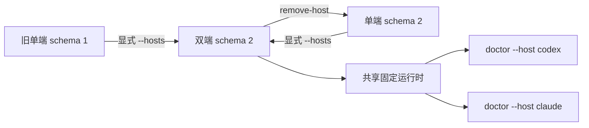

# 安装与首次使用

本页对应 **0.9.3-dual-host.1 双宿主安装候选**（实现分支 `work/dual-host-coexistence`），基于已合并的 0.9.2。只在获准目标安装；不替换全局技能，不自动升级其他项目。17 项技能本体不增加新职责，Goal 契约保持原语义。

## 快速开始：Windows + Codex

基线 0.9.1 曾获准纳入 `work/061-through-09`，其[纳入回执](../../iterations/0.9.1/PROMOTION.md)不自动批准本双宿主候选晋级或其他现用安装升级。先取得并核对选定版本的源码，把下面 `$Source` 改为源码根目录（其中有 `package.json` 和 `bin/ff-install.mjs`）。`$Project` 是你要使用 FF 的获准目标项目，两者可以不同。已有安装先盘点；[历史布局参考](../archive/installation/项目内安装指南.md)保留当时结构，当前重入/恢复操作以本页为准，不把同版本号的不同包哈希当作相同安装。

先准备 **Node.js >=20.19.0、npm、Git、tar**；三个可选只读检查器还需 **Python 3.9+**。full 构建需要访问 GitHub 和下载构建依赖。以下 PowerShell 示例把项目、外层 npm 缓存和临时目录放在 E 盘；旧项目请将 `$Project` 改为现有项目根目录。

```powershell
$Source = 'E:\tools\ForgeFlowSkill' # 已检出并核对的本仓库源码根目录
$Project = 'E:\projects\my-project'
$Cache = 'E:\forgeflow-cache'
New-Item -ItemType Directory -Force -Path $Project, "$Cache\tmp" | Out-Null
$env:TEMP = "$Cache\tmp"
$env:TMP = $env:TEMP
$env:npm_config_cache = "$Cache\npm"
node "$Source\bin\ff-install.mjs" install --project "$Project" --host codex --mode full --build
Set-Location $Project
node .forgeflow/install/doctor.mjs
node .forgeflow/ff-spec.mjs --help
```

`--build` 明确允许安装器构建本地 CLI。**未发布到 npm registry**；不要假定存在可直接安装的公开 FF npm 版本。原生 Windows full 构建/安装已在 0.8/0.9 冻结提交执行，具体版本与哈希见对应[版本与证据](../archive/README.md)。

安装内容位于项目的 `.forgeflow/` 与 `.agents/skills/`。full 构建的内层缓存和临时数据仍在项目 `.forgeflow/install/` 下；上述外层设置不保证所有系统工具都不写项目外文件。工具源无需复制进每个项目，也不替换全局 OpenSpec。

只要技能、暂不需要 CLI 门禁：将 `--mode full --build` 改为 `--mode skills-only`。此模式的 doctor 和 CLI 会返回 **BLOCKED**。Claude Code 将宿主参数改为 `--host claude`，技能安装至 `.claude/skills/`，原生 ff-intake 仅有人工空白项目的[限定成功回执](../../iterations/0.9.3-dual-host.1/native-host-validation.md)，不代表所有技能或实际业务验收。CodeGraph 默认关闭。


## 同一项目同时供 Codex 和 Claude 使用

把单数 `--host codex` 改为显式的 `--hosts codex,claude`。目标项目已有单端安装时，同一命令迁移到双端；顺序 `claude,codex` 也可。每端仍各有 17 项技能，不是 34 个不同技能。

```powershell
node "$Source\bin\ff-install.mjs" install --project "$Project" --hosts codex,claude --mode full --build
node "$Source\bin\ff-install.mjs" doctor --project "$Project" --host codex
node "$Source\bin\ff-install.mjs" doctor --project "$Project" --host claude
# 在目标项目根目录也可独立自检，无需保留安装器源码：
node .forgeflow/install/doctor.mjs --host codex
node .forgeflow/install/doctor.mjs --host claude
```

Codex 读取 `.agents/skills/ff-*`，Claude 读取 `.claude/skills/ff-*`；两端绑定同一 `.forgeflow/ff-spec.mjs`、版本、manifest、模式和 release。`doctor --host` 检查指定端托管文件、共同依赖和真实 CLI 探测；省略宿主检查全部。另一端普通文件损坏不会伪装成所选端损坏，但共同文件、路径或状态异常仍会阻止。**READY 证明文件与 CLI 可用，不证明宿主模型已经加载/调用技能，也不证明业务或真人验收。** 后续独立模型试验中 Claude 限定 ff-intake 成功、Codex 原读取受策略阻塞；二者不由 doctor 状态推导。

双端升级继续用 `--hosts codex,claude`；单数参数会阻止意外删掉另一端。旧 schema 1 单端安装保留旧参数和单端切换语义；双端迁移使用 schema 2，移除一端后仍是 schema 2。两端不能混用不同版本或 full/skills-only 模式；两种模式之间可显式重装，full 仍需 `--build`。同版本、同 manifest、同宿主集合及同模式重入不改状态字节。

只移除一端，例如保留 Codex：

```powershell
node "$Source\bin\ff-install.mjs" remove-host --project "$Project" --host claude
node "$Source\bin\ff-install.mjs" doctor --project "$Project" --host codex
```

只删除该端有哈希记录的文件，不递归删除技能目录；其中用户额外文件、另一端和共享运行时保持。已移除端重复移除返回 `UNCHANGED`；拒绝删除最后一端，本轮没有完整卸载器。重新添加仍用 `--hosts codex,claude`。新增端已有未托管同名文件，或任一端托管文件/共享运行时有用户改动时，安装、移除和回滚都会阻止并保留现场，不覆盖文件。



`rollback` 回退前一整笔项目安装：宿主集合、版本、模式一起恢复；它不是仅回退所选端。`recover` 也处理整笔事务。不要同时运行两个安装器；文件就绪不提供两个模型并发修改业务文件的协调机制。

## 当前验证边界

技能/安装包版本为 **0.9.3-dual-host.1**；固定 FF CLI 的 `--version` 为 **1.14.2-ff.0.5.0-rc3**，两者标识不同层次。skills-only 没有可用的 full CLI，不能据此要求版本输出成功。Goal 契约沿用 0.9.2，原生写入与状态同步未实现；使用与实验边界见[Codex Goal](codex-goal.md)。本轮验证范围和未测项见[双宿主安装回执](../../iterations/0.9.3-dual-host.1/README.md)。

安装与证据按完整提交、manifest 和 payload 哈希区分，不能只看版本号。0.9.2-goal.2 已有实际 Windows/Codex 隔离项目 full 构建、安装及 doctor READY；skills-only 的 doctor 为预期 BLOCKED。选定桌面后端的技能加载/调用已有有界观察，包与提交、后续文档包的继承理由见[原生验证与证据继承](../../iterations/0.9.2-goal.2/native-closeout.md)。这些不是全平台或产品真人验收。

历史失败仍保留：71d0464 原候选有 full 构建/CLI 记录；46022d7 文档包两次 full 构建因 npm TLS 下载失败，仅 skills-only 新包安装/Health 入口通过。此前成功不自动覆盖其他包；旧 PATH CLI 的 Codex setup refresh 故障不能概括为当前所有桌面后端均失败。Claude 当前仅有上述有界原生 ff-intake 结果；两端完整模型工作流、全平台与产品真人验收仍未证明。

仅需技能时用 `--mode skills-only`，不要同时加 `--build`。成功状态是 `INSTALLED_SKILLS_ONLY_GATES_BLOCKED`，不是 full READY；17 项技能可分发，FF CLI 门禁不可用。full 依赖网络下载固定构建依赖，不修改锁文件、TLS 或权限来绕过失败。

安装路径是目标项目的 `.agents/skills/`（Codex）或 `.claude/skills/`（Claude），控制与运行目录在 `.forgeflow/`。外层 npm cache/TEMP 可放 E 盘，full 内层缓存仍在目标项目；不承诺所有系统工具完全不写其他位置。

## 重入、回滚与恢复

同一 host/mode/manifest 可返回 `UNCHANGED`；同版本号不同包哈希不代表相同安装。已有安装先盘点并保存用户修改，不手工覆盖技能目录。维护命令从已核对源码运行，`$Project` 为实际目标项目：

```powershell
node "$Source\installer.mjs" doctor --project "$Project"
node "$Source\installer.mjs" rollback --project "$Project"
node "$Source\installer.mjs" recover --project "$Project"
```

后两项会改变安装状态，只在已有相应授权、无运行中的安装且核对诊断后使用；有 lock/pending 或部分输出先检查，不盲重试或删除现场。旧说明的实现细节保留在[历史安装资料](../archive/README.md#历史安装资料)，不作为本版已验收承诺。

安装后的使用请求、实际 CLI/Python 入口见[能力与使用场景](capabilities.md)。源码构建、打包与验证见[开发维护](../maintainers/development.md)。本仓库没有已发布 npm 包，不把历史 npx 指令或浮动 main 当当前工作分支安装来源。


doctor 是只读检查。安装器异常退出后，先确认对应安装进程已结束，再仅移除其**空的** `.forgeflow/install/lock` 目录，运行 recover；不要删除 pending、backup 或整个安装目录。提交前中断返回 `RECOVERED` 并恢复原托管文件；state 已原子提交则核对最终文件与状态后返回 `COMMITTED`。有后续用户改动会保留 pending 并报冲突，须明确处理冲突再恢复；它不提供磁盘断电级原子性保证。
