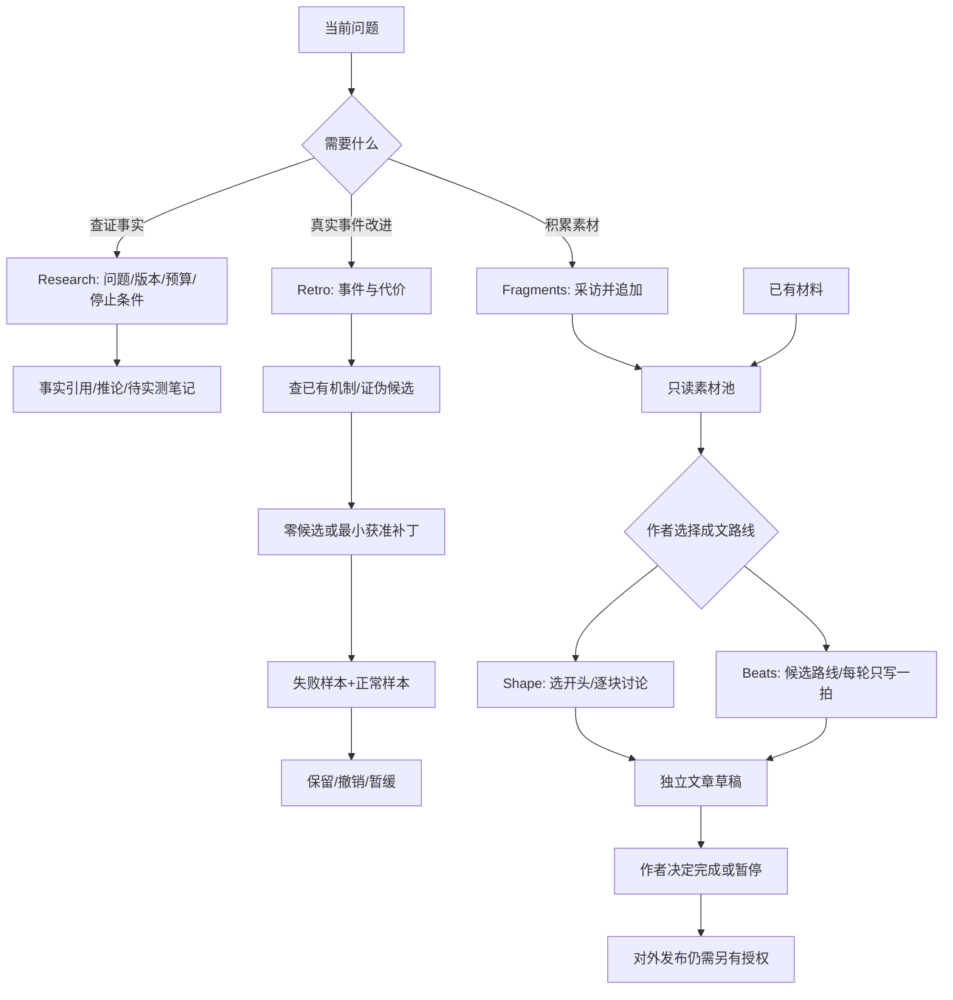

# FF 可选方法：研究、复盘与互动写作

本文保留原实验的方法示例与验证边界；当前能力和安装后命令见[能力与场景](capabilities.md)。下列 `tools/...`、`templates/...` 和 `provenance/...` 均以源码根目录为基准，不以本文所在目录为基准。

版本：0.6.0-experimental.1。基于冻结0.5.0-rc3另开实验，不更改该版本交付。十二技能保持原职责，另增加五个按需入口，共十七个；没有十七步流水线。未全局安装、未发布、未合并主分支，真实用户尚未验收。

## 如何选

- 具体事实/版本能力不确定：ff-research，交付带逐条一手引用的笔记，区分事实、推论、待实测。
- 有真实工作失误或代价要复盘：ff-retro，先查已有机制，再决定是否有最小改进；零候选正常。
- 还没有结构、想挖素材：ff-writing-fragments，只采访与追加碎片，不出大纲。
- 已有材料、想逐段打磨论证：ff-writing-shape，先选开头，再逐块同意后落盘。
- 已有材料、想在不同叙事方向间选择：ff-writing-beats，每轮选一个节拍，只写这个节拍。

shape 与 beats 是两条替代路线，用户可选其一或明确切换；不要求先 fragments，更不要求先 research。已有素材可以直接成文。研究结果可以单独结束，复盘也可单独调用。只有示例博客场景确实需要查事实时才采用所示依赖链；retro 不在写作必经链里。

## 一个最小互动示例

用户：“用 ff-writing-beats，根据 notes.md 写到 draft.md，读者懂集合但不懂顺序保证。”

助手先完整读 notes.md 和已有 draft.md，再提供2–3个可达起始节拍，并说明各自铺垫概念。作者未选时不写文章；选一个后只写该节拍。下一轮重读文件，尊重作者插入或删除，重新计算当前铺垫。若需要“我在生产踩过的坑”而材料没有，就请作者补充或删去该论点，不能代作者编故事。

## 可编辑流程图

## CLI 能做什么，不能做什么

现有 ff-spec 基于 OpenSpec 的自定义 schema 可追踪任意命名文件产物，不限于代码规格。CLI 创建 change 骨架、输出 instructions、检查状态与FF指纹、验证和归档；它不会自动研究、采访或写出文章。技能负责互动与产物生成，CLI只负责配置驱动的生命周期。文档出现“done”可能只是schema观察到文件，必须另外检查 ffValidity；不要把文件存在或说明输出当质量通过。

示例配置位于 templates/optional-methods/openspec：5个独立 schema，以及 ff-blog-shape、ff-blog-beats 两套不同依赖链。它们是复制后按本项目修改的示例，不是自动安装脚本。博客schema的 writing-shape.md / writing-beats.md 保存选择、概念与缺口工作记录，draft.md 是独立文章；单项schema的输出可直接是该方法产物。若项目已有其他文件名，显式调整 generates 与 policy.paths，不能靠名称猜测。

1. 按已有项目约定选择输出；小任务可以只用技能而不启用CLI。
2. 要追踪时，把选中schema目录复制到目标项目 openspec/schemas/ 下；只选需要的路线。已有配置先读取合并，不覆盖。
3. 在项目根用项目本地 launcher 执行：node tools/openspec/ff-spec.mjs new change article-demo --schema ff-blog-shape。
4. 在该change的 .openspec.yaml 中保留实际schema并显式设置 skip_specs: true。不要把文章/研究/复盘放进 specs/ 子目录。change-metadata.yaml 是示例，不要直接覆盖已有元数据。
5. 对照对应 policies/*.json，将 CHANGE_NAME 替换为实际change名，合并到 openspec/ff-policy.json，保留其他artifact；项目policy ID须唯一，多个活动change应使用稳定且不冲突的ID并同步schema。不要复制任何历史回执。
6. 用 instructions <artifact-id> --change article-demo 查看当前指导；只按授权与作者本轮选择写目标文件。用 status --change article-demo --json 查看 ffValidity。后续review按 docs/maintainers/SPEC-LIFECYCLE.md 绑定真实当前指纹、schema/policy与证据，独立执行；本包不提供自动签pass工具。
7. 上游内容改变后，不靠重新保存回执蒙混过关：核对依赖，更新实际受影响产物，独立重审。未发生依赖变化的独立产物无需重跑整套方法。
8. 使用 validate article-demo --strict --json 验证。正常 archive article-demo --yes --json 只在真实必要审核/授权具备时执行；skip_specs: true 保证本非规格示例不把草稿提升为现行规格。归档是生命周期收尾，不是发布。
9. 取消/拒绝用现有 --ff-disposition canceled 或 rejected，附真实 --ff-reason 和 --ff-decision-ref；保留未完成或失败回执，不改成pass，不同步现行specs。不要套用测试中的合成决议。

以上省略命令前缀处均使用同一项目本地launcher。未经FF policy启用的项目没有FF版本门禁；官方OpenSpec入口也不会执行FF gate。此限制不能靠提示词当安全认证解决。

## 来源与差异

五项均参考 Matt Pocock skills 固定提交49dd158d1076134a641b33efb035946536778336；writing三项原路径在 in-progress，不能称作上游稳定功能。每项保留原文、MIT许可、URL与SHA-256。FF新增预算/停止条件、真实证据、授权范围、零候选复盘、并发编辑保护与不自动发布边界；这些是本地改编，不归因成Matt原文功能。见 provenance/optional-methods-change-sources.json 与各技能NOTICE。

## 验证边界

机器测试证明CLI配置与拒绝路径，不证明文章质量、研究准确性、真实独立评审者身份或用户批准。新上下文模型情景测试只说明测试提示下的行为，不替代宿主安装调用与真实用户验收。旧0.5报告保持历史，只能证明当时那一版本；该轮详见[可选方法测试报告](../archive/reports/可选方法测试报告.md)。
