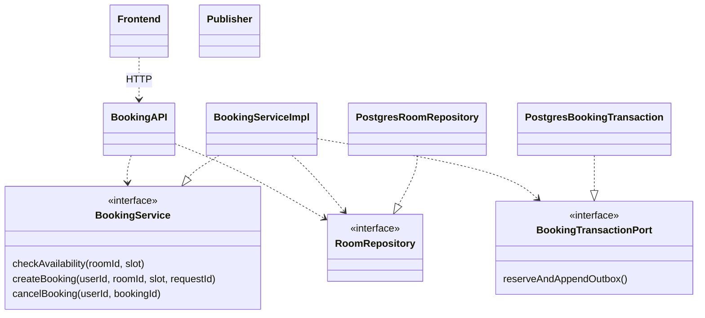
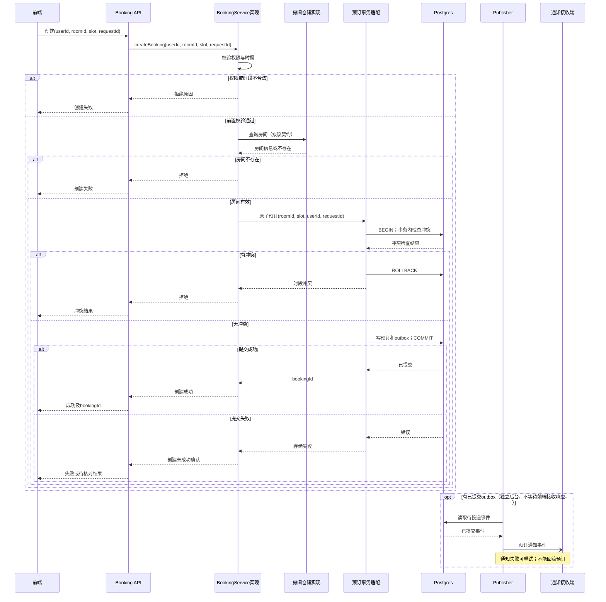

# 会议室预订服务：开发交接架构候选

本稿只说明已给定的预订范围；分为 API 入口、业务、基础设施三个职责区，前端作为外部消费方。三个职责区不等于三个进程。把 API 与业务合并虽少一个边界，但会耦合协议与预订规则；保留给定边界便于独立测试。目录均为拟议，未查看实现仓库。

|职责区|组件与职责|依赖及拟议目录|
|---|---|---|
|入口|Booking API：输入解析、调用契约、把业务结果转换为响应；不决定预订冲突|依赖 BookingService、RoomRepository 的接口，不导入 Postgres 实现；`api/`|
|业务|BookingService：可用性、创建、取消的规则与状态决定；RoomRepository：房间访问契约|不依赖数据库实现；`booking/`、`booking/ports/`|
|基础设施|PostgresRoomRepository：实现房间读取；预订事务适配：在同一事务中查冲突、写预订/outbox；Publisher：读取已提交 outbox 并投递|实现业务契约、依赖 Postgres；`infrastructure/postgres/`、`workers/publisher/`|

事务适配是候选能力，不把其函数都拆为独立模块；真实存储接口尚未给定。组装入口 `bootstrap/`（拟议）把实现传给消费者即可，无需引入 DI 容器。API 对 RoomRepository 的具体直接调用场景未给出，静态图保留已确认依赖，但创建路径不臆造一次多余读取。

## 静态依赖视图
虚线箭头表示源码依赖；空心三角方向表示实现→接口，不表示运行数据流。

Publisher 属于基础设施，独立读取已提交 outbox；它不成为 BookingService 的同步依赖。图中的事务端口、服务实现名称为拟议，不冒称已存在。

## 一次创建请求的运行视图
实线实心箭头为同步调用，虚线箭头为返回，空心箭头为异步通知。

## 应保留为文字的约束
- `checkAvailability` 是查询时刻的结果，不是预留；创建必须在事务内再次检查。并发互斥不能靠先查再写的普通事务自动保证：拟议使用数据库约束或锁/隔离策略，具体方案待验证；同房间重叠预订的并发验收须只有一个成功。
- 预订与 outbox 必须原子提交。通知失败不影响已提交状态；Publisher 重试、投递去重与清理策略尚待决定。
- `requestId` 已有输入，但其幂等范围、保存期、同键不同内容响应待确认；不能把“传了 ID”当作已经去重。
- `cancelBooking` 校验调用者及取消资格，由业务决定取消状态，再由事务持久化；取消截止时间、取消是否发事件待确认，不编造规则。
- 权限来源、时区、时段端点是否重叠、房间停用规则、提交结果未知时的核对协议待确认。提交失败与提交结果未知须区分，不能让客户端盲目重复创建。
- 这些是跨调用约束，不把每条规则或三个方法各画成一个模块。

验收交接：权限/非法时段不写库；冲突不写预订/outbox；成功两者同时存在；回滚两者都不存在；模拟 Publisher 失败仍能查到预订；并发重叠与 requestId 重放按确认后的规则验收。更换房间存储主要影响仓储实现和组装，但事务能力、查询语义变化也可能波及业务契约，不承诺只改一个文件。

## 来源与验证边界
需求来源为本案用户原文；事实与候选分开，未实施业务代码、未运行产品测试，用户接受待确认。技能来源为基准 commit `6468847234f1e30c3ff8b186c38790de93c45293` 的 `skills/ff-spec/SKILL.md` 及 `references/full-workflow.md`；架构案另使用 `skills/ff-architecture-derive/SKILL.md` 与 `references/architecture-derivation.md`。只通过 `git show` 读取这些内容，未读工作树候选或评审文件。

按国内工程文档常见实践分开需求、结构、行为、约束和验收。官方目录列有现行的[GB/T 8567-2006《计算机软件文档编制规范》](https://openstd.samr.gov.cn/bzgk/std/std_list?p.p1=0&p.p2=8567-2006&p.p90=circulation_date&p.p91=desc)及[GB/T 9385-2008《计算机软件需求规格说明规范》](https://openstd.samr.gov.cn/bzgk/std/newGbInfo?hcno=2790825C43AD0B69E3C38C140BFFCFE6)。本次只核实目录信息，未核正文及逐条适用性，不宣称符合国标，图形记法为本稿说明的工程表达。

本案为六案共用一个模型上下文中的独立输出，不等于六次隔离运行。图源如有附于文中，未经 Mermaid 渲染器验证；未作独立审查或自评分。
