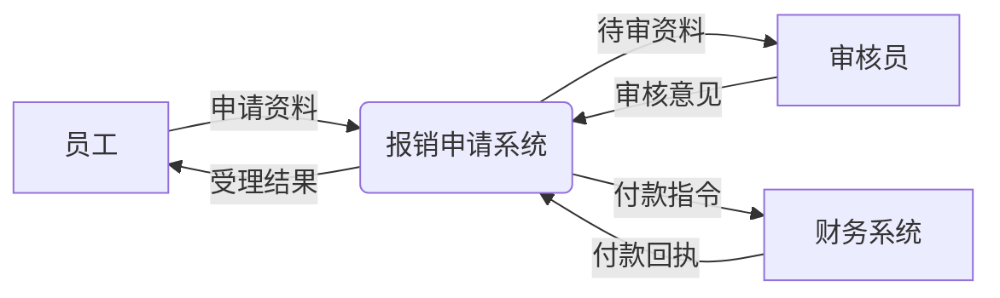
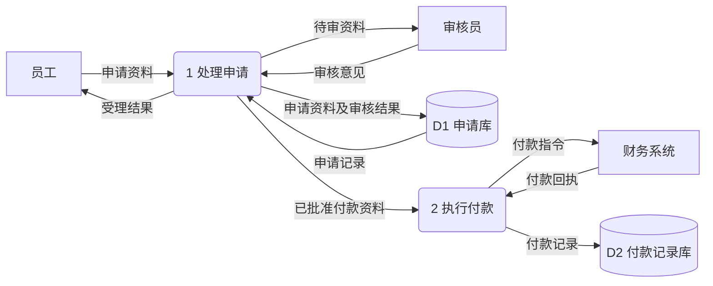
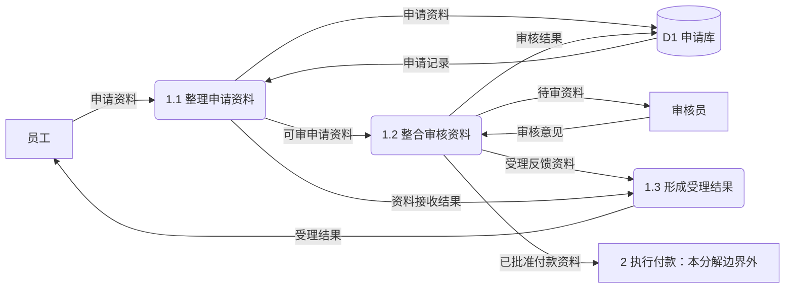

# 报销申请系统数据流说明

图中矩形为外部实体，圆角为处理，双竖线形为数据存储；所有箭头表示具名数据，不表示先后执行或审批控制。上下文的系统边界不显示内部存储。未增加外部参与方。

## 上下文图

## 一级数据流图

上述存储以 Mermaid 圆柱替代传统开口存储框，仅是绘图工具替代，不改变 DFD 语义。没有实体直连存储、存储互连，也没有把财务回执直接回写申请库，因为需求未授权该数据流。

## “1 处理申请”的分解
子处理编号不表示时间顺序。这里的“整合”表示处理输入数据形成输出，不是审批步骤按钮。

## 父子平衡与数据含义
|1 的边界流|子图对应|
|---|---|
|员工→申请资料|员工→1.1，名称及内容保持|
|审核员→审核意见|审核员→1.2|
|申请库→申请记录|申请库→1.1|
|1→受理结果→员工|1.3→员工|
|1→待审资料→审核员|1.2→审核员|
|1→申请资料及审核结果→申请库|1.1 写申请资料 + 1.2 写审核结果，聚合等价|
|1→已批准付款资料→2|1.2→2|

申请资料包含初次提交及补充材料，但补充的匹配标识、必填项待确认。审核意见可包含批准、驳回、需补充及原因；受理结果承载相应反馈，不把这些动作另画成控制流箭头。已批准付款资料必须足以生成付款指令，字段及审批有效性规则待确认。付款回执与付款记录的字段、重复回执处理、失败重试规则未确定，本稿不补造。

验收：逐一追踪六条外部流在上下文和一级图均有对应；1 的七类边界流在子图保持，子图不新增财务接口。业务讨论须确认受理结果是否覆盖审核后的驳回/补充通知；若不覆盖，先修正父图数据接口再分解，不能只在子图偷偷加新流。

## 来源与验证边界
需求来源为本案用户原文；事实与候选分开，未实施业务代码、未运行产品测试，用户接受待确认。技能来源为基准 commit `6468847234f1e30c3ff8b186c38790de93c45293` 的 `skills/ff-spec/SKILL.md` 及 `references/full-workflow.md`；架构案另使用 `skills/ff-architecture-derive/SKILL.md` 与 `references/architecture-derivation.md`。只通过 `git show` 读取这些内容，未读工作树候选或评审文件。

按国内工程文档常见实践分开需求、结构、行为、约束和验收。官方目录列有现行的[GB/T 8567-2006《计算机软件文档编制规范》](https://openstd.samr.gov.cn/bzgk/std/std_list?p.p1=0&p.p2=8567-2006&p.p90=circulation_date&p.p91=desc)及[GB/T 9385-2008《计算机软件需求规格说明规范》](https://openstd.samr.gov.cn/bzgk/std/newGbInfo?hcno=2790825C43AD0B69E3C38C140BFFCFE6)。本次只核实目录信息，未核正文及逐条适用性，不宣称符合国标，图形记法为本稿说明的工程表达。

本案为六案共用一个模型上下文中的独立输出，不等于六次隔离运行。图源如有附于文中，未经 Mermaid 渲染器验证；未作独立审查或自评分。
