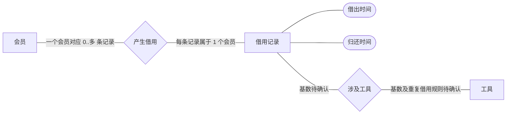

# 社区共享工具：概念 ER 讨论稿

只建业务概念，不设计数据库表、主键、外键或关联表。会员与借用记录的关系已确认；借用记录与工具的基数故意留空，不能把未确认规则画成确定的一对多或多对多。

记法为概念 ER 风格：矩形为实体、菱形为联系、椭圆为属性；边上写业务基数而不是数据库字段。会员可尚未借用，因此会员的记录数暂按 0..多理解；若业务要求“会员必须已有借用”则需要业务纠正。借出/归还时间属于一次借用记录，不属于工具或会员的固有属性。是否允许未归还时归还时间为空、如何表示预计归还时间需确认。

## 访谈必须保留的两个决策
1. 一条借用记录只能涉及一件工具，还是可包含多件？可多件时，各工具可能不同时间归还吗？若时间不同，当前记录级时间不能独自表达，需讨论借用明细这一新概念，而不是提前加入关联表。
2. 同一工具何时可以再被借用？只允许前次归还后、允许预约不同时段、还是工具代表可用多件库存的类别？这决定“工具”的业务粒度和借用可重叠性。多次历史借用与同时借用是不同问题，不能混为多对多关系的结论。

可以用三张真实业务卡验证概念：会员甲一次借锤子；甲一次想借锤子和梯子；甲尚未归还时乙想借同一锤子。后两张先收集业务答案，未回答前不要生成物理 ER 或唯一约束。交付界限：已确定概念及会员归属可讨论；工具关系基数和并发规则保持待确认，尚不能据此直接建库。

## 来源与验证边界
需求来源为本案用户原文；事实与候选分开，未实施业务代码、未运行产品测试，用户接受待确认。技能来源为基准 commit `6468847234f1e30c3ff8b186c38790de93c45293` 的 `skills/ff-spec/SKILL.md` 及 `references/full-workflow.md`；架构案另使用 `skills/ff-architecture-derive/SKILL.md` 与 `references/architecture-derivation.md`。只通过 `git show` 读取这些内容，未读工作树候选或评审文件。

按国内工程文档常见实践分开需求、结构、行为、约束和验收。官方目录列有现行的[GB/T 8567-2006《计算机软件文档编制规范》](https://openstd.samr.gov.cn/bzgk/std/std_list?p.p1=0&p.p2=8567-2006&p.p90=circulation_date&p.p91=desc)及[GB/T 9385-2008《计算机软件需求规格说明规范》](https://openstd.samr.gov.cn/bzgk/std/newGbInfo?hcno=2790825C43AD0B69E3C38C140BFFCFE6)。本次只核实目录信息，未核正文及逐条适用性，不宣称符合国标，图形记法为本稿说明的工程表达。

本案为六案共用一个模型上下文中的独立输出，不等于六次隔离运行。图源如有附于文中，未经 Mermaid 渲染器验证；未作独立审查或自评分。
