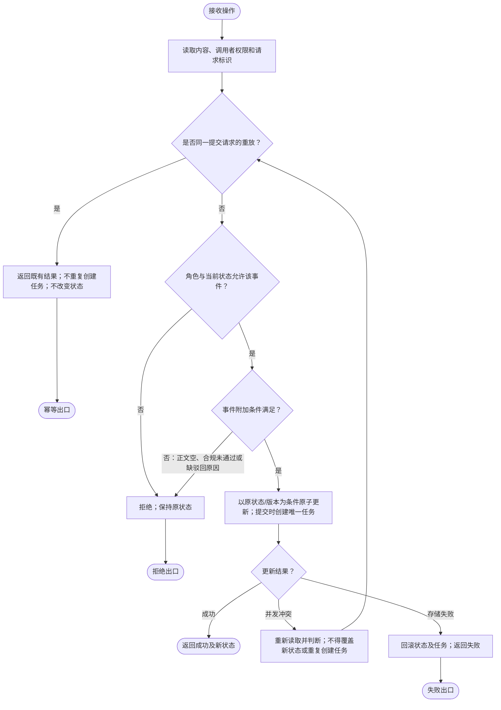

# 内容审核：状态与处理流程

事件标注格式为 `事件 [条件] / 动作`。作者/审核员指对该内容有相应权限的调用者，不只靠客户端传入角色。只保留给定五个业务状态，不添加超时自动批准或新的结束状态。

## 状态图
```mermaid
stateDiagram-v2
state 草稿 as Draft
state 待审核 as Pending
state 已发布 as Published
state 已驳回 as Rejected
state 已撤回 as Withdrawn
Draft --> Pending: 提交 [作者且正文非空] / 原子创建一次审核任务
Rejected --> Pending: 提交 [作者且正文非空] / 原子创建一次审核任务
Pending --> Published: 批准 [审核员且合规检查通过] / 发布
Pending --> Rejected: 驳回 [审核员且原因非空] / 保存原因
Pending --> Withdrawn: 撤回 [作者] / 撤回内容
Published --> Withdrawn: 撤回 [作者] / 撤回内容
note right of Pending
重复提交不创建新任务；状态保持
其他条件不满足均拒绝并保持原状态
end note
note right of Withdrawn
未指定恢复或重新提交能力
不自动增加出口
end note
```

草稿是给定状态之一，未指定内容如何创建，因此不额外画初始创建迁移。已撤回也不等同于 UML 终止节点。所有未画出的操作均拒绝且保持原状态；这包括已发布再次批准、草稿撤回、已撤回提交。

## 简洁处理流程


幂等判断仍须鉴权后才向合法调用者返回原结果，不能泄漏别人的请求结果。请求标识、版本条件及唯一性是拟议实现机制，不增加业务状态。相同请求重放返回既有结果是建议；若无可识别请求标识，待审核状态再次提交应拒绝且不创建任务。具体重复请求响应契约待确认，硬约束始终是“不新增任务、不非法迁移”。

## 可直接转成测试的数据表
|原状态/事件|通过条件|结果|
|---|---|---|
|草稿或已驳回/提交|作者、正文非空|待审核；仅一个本轮任务|
|待审核/批准|审核员、合规检查通过|已发布|
|待审核/驳回|审核员、原因非空|已驳回；保存原因|
|待审核或已发布/撤回|作者|已撤回|
|上述任一合法组合但条件不满足|无|拒绝；原状态与任务保持|
|不在上述组合中的任意状态/事件|无|拒绝；原状态与任务保持|
|重复提交|重放或待审核再次提交|不得新增任务；状态不变|

对五种状态×提交/批准/驳回/撤回构造覆盖，并为每个合法迁移补错误角色、空正文/原因、合规失败案例。加两次并发提交、批准与撤回并发、任务写失败测试，要求单一一致结果而不是两条状态都生效。合规服务超时不能当作通过，维持待审核并返回失败/待重试的具体响应待确认。无定时自动批准测试路径。

## 来源与验证边界
需求来源为本案用户原文；事实与候选分开，未实施业务代码、未运行产品测试，用户接受待确认。技能来源为基准 commit `6468847234f1e30c3ff8b186c38790de93c45293` 的 `skills/ff-spec/SKILL.md` 及 `references/full-workflow.md`；架构案另使用 `skills/ff-architecture-derive/SKILL.md` 与 `references/architecture-derivation.md`。只通过 `git show` 读取这些内容，未读工作树候选或评审文件。

按国内工程文档常见实践分开需求、结构、行为、约束和验收。官方目录列有现行的[GB/T 8567-2006《计算机软件文档编制规范》](https://openstd.samr.gov.cn/bzgk/std/std_list?p.p1=0&p.p2=8567-2006&p.p90=circulation_date&p.p91=desc)及[GB/T 9385-2008《计算机软件需求规格说明规范》](https://openstd.samr.gov.cn/bzgk/std/newGbInfo?hcno=2790825C43AD0B69E3C38C140BFFCFE6)。本次只核实目录信息，未核正文及逐条适用性，不宣称符合国标，图形记法为本稿说明的工程表达。

本案为六案共用一个模型上下文中的独立输出，不等于六次隔离运行。图源如有附于文中，未经 Mermaid 渲染器验证；未作独立审查或自评分。
