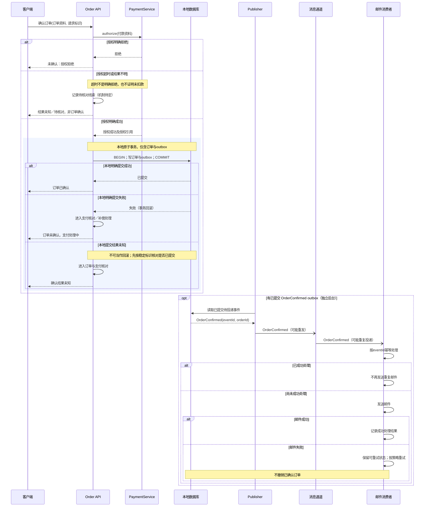

# 订单确认路径：UML 时序与失败边界

以下采用 UML 时序语义：`->>` 为同步调用，`-->>` 为调用返回，`-)` 为异步消息。Publisher 的片段独立于客户端请求，只有已提交 outbox 才可成为消息来源；图中位置不要求客户端先收到响应。

## 四类边界不能合并
- **授权拒绝**：已知没有获得本次有效授权，不创建订单/outbox，不发送确认事件。
- **授权超时**：支付结果未知，不写“确认订单”事务；保留商户请求/授权引用做查询与核对，禁止把超时解释成“没扣款”后无脑再次 authorize。支付端查询及幂等能力未给出，需确认协议。
- **已授权但本地明确失败**：本地订单/outbox 不存在，禁止发布确认事件；进入支付核对/撤销或退款等补偿流程。选择撤销还是退款取决于支付阶段与服务能力，不能预设；补偿可能失败，须可观察、重试或升级人工处置，责任与时限待定。
- **提交结果未知**：与明确失败分开处理。数据库实际可能已提交；先按稳定标识核对，避免对已确认订单错误退款。若确认已提交，才可发布其 outbox。

客户端响应丢失不等于订单未提交；重试确认接口须避免重复授权和重复订单，具体请求键契约待定。Publisher 发送后记投递状态前崩溃会重发，因此不是恰好一次投递。邮件幂等须覆盖并发与“邮件已发送但去重记录未写成”的窗口；若邮件服务无幂等键，无法仅靠消费端记录承诺严格不重复，需明确剩余风险及策略。邮件失败永不反向撤单。

测试交接：分别注入授权拒绝、授权超时、事务回滚、提交响应丢失、Publisher 重投、邮件失败；观察订单、outbox、支付核对记录和邮件发送次数，不能只看 API 返回码。以上均为待实施验证的边界，尚无运行证据。

## 来源与验证边界
需求来源为本案用户原文；事实与候选分开，未实施业务代码、未运行产品测试，用户接受待确认。技能来源为基准 commit `6468847234f1e30c3ff8b186c38790de93c45293` 的 `skills/ff-spec/SKILL.md` 及 `references/full-workflow.md`；架构案另使用 `skills/ff-architecture-derive/SKILL.md` 与 `references/architecture-derivation.md`。只通过 `git show` 读取这些内容，未读工作树候选或评审文件。

按国内工程文档常见实践分开需求、结构、行为、约束和验收。官方目录列有现行的[GB/T 8567-2006《计算机软件文档编制规范》](https://openstd.samr.gov.cn/bzgk/std/std_list?p.p1=0&p.p2=8567-2006&p.p90=circulation_date&p.p91=desc)及[GB/T 9385-2008《计算机软件需求规格说明规范》](https://openstd.samr.gov.cn/bzgk/std/newGbInfo?hcno=2790825C43AD0B69E3C38C140BFFCFE6)。本次只核实目录信息，未核正文及逐条适用性，不宣称符合国标，图形记法为本稿说明的工程表达。

本案为六案共用一个模型上下文中的独立输出，不等于六次隔离运行。图源如有附于文中，未经 Mermaid 渲染器验证；未作独立审查或自评分。
