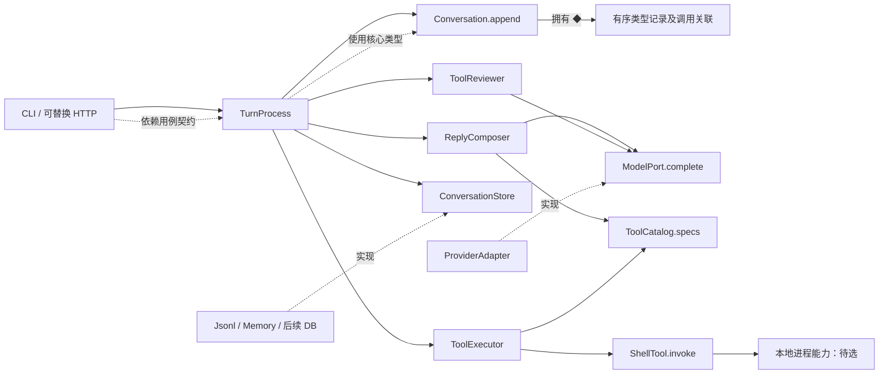

# 多轮工具 Agent 后端：独立首次架构候选

状态：AI 拟议，未实现、未实测、未经用户确认或独立评审。仅依据本次任务、交付说明及指定 FF 推导技能；未查阅代码、既有 Harness、供应商文档或视频答案。下列组件、契约、目录均为拟议，不代表已有能力。

## 1. 建议结构与一条主链

建议 **三个逻辑职责区**：会话核心、交互过程、外部适配。组装根是启动位置，不另算一层；这不是三个服务或三个部署单元。

- **会话核心**：会话身份、追加记录及调用与结果关联。不认识模型供应商、文件、HTTP。
- **交互过程**：决定一次用户输入后如何生成、审查、执行、继续、终止与保存。持有模型及存储的业务契约，并分开正常生成和审查的输入组织。
- **外部适配**：入口、模型供应商、存储与具体工具的现实实现。它们变化来源不同，可在同一外侧职责区分模块；并不互相直接调用。

主要运行链：`入口.submit → TurnProcess → ConversationStore.load/create → Conversation.append(user) → ReplyComposer.generate → ModelPort.complete → ToolReviewer.review → ModelPort.complete → ToolExecutor.execute → ShellTool.invoke → Conversation.append(tool result) → 再次生成 → ConversationStore.save → 入口展示结果`。无工具请求时跳过审查与执行；拒绝时追加拒绝结果而不是执行。TurnProcess 接收各操作结果并决定下一步，不由模型适配器决定业务循环。

## 2. 从需求形成对象与边界

以下编号仅为本候选的追溯索引，不是新增规格。

| 依据 | 推导出的必要职责 | 边界理由 |
|---|---|---|
| R1 开始/继续对话、追加、保存、读取、列表 | Conversation 与 ConversationStore | 对话规则不同于文件格式；同一份会话可由文件或数据库存取 |
| R2 输入包括指令、历史、工具说明 | ReplyComposer 与 ToolCatalog | 输入组织属于生成用途；工具描述应来自可执行工具登记，避免描述与执行名称脱节 |
| R3 模型请求/响应因供应商变化 | 中立 ModelPort 与 ProviderAdapter | 过程消费规范化消息及调用请求，不解析供应商字段；真实格式映射留在适配器 |
| R4 审查使用相关对话、拟调用、专用指令及结论 | ToolReviewer | 与回复生成的输入、输出验证及模型配置不同，不能让回复文本冒充审查结论 |
| R5 允许执行/拒绝并回填 | ToolExecutor 与具体工具 | 审查决定是否放行，执行器负责查找工具、参数校验、真正调用并返回结果；两者不混同 |
| R6 多轮直到无调用，且有上限 | TurnProcess | 跨上述职责的顺序、追加时机和退出决定需要一个明确所有者；不在适配器散落循环 |
| R7 HTTP/CLI 可换、启动需接通 | EntryAdapter 与 composition | 传输解析不进入会话规则；启动处显式选择具体实现，不需要 DI 框架 |

### 同一边界的拆/并选择

正常生成与审查可以合并为一个带 `mode` 的函数，减少一个模块；但会使指令选择、输入裁剪、预期输出解析和失败规则混在一起。这里拆为 ReplyComposer 与 ToolReviewer：共用 ModelPort，不再各造一套供应商客户端接口。代价是两个小模块与两组配置；收益是换审查模型或结论格式不影响正常回答组织。两者均为本地函数/对象，不要求独立服务。

入口也可单独作为第四层。本轮一个简单入口没有独立业务规则，故与其他协议适配同属外侧区，但目录隔离。若之后出现复杂认证或公共 API 版本治理，再讨论是否单独分区；这不是本轮必做。

未提供已有框架能力，无法判断能否直接复用成熟循环。当前 TurnProcess 是所需过程的概念落点，并非认定必须重造某个现有 Harness；若实施时选定能满足本契约的现成能力，应复用并映射职责，不保留同义包装。

## 3. 组件、契约与状态

以下伪签名是项目内部拟议契约，**不是任何供应商 SDK API**。语言未选定。`Result<T, Failure>` 表示调用方必须区分成功和失败。

### 会话核心：拟议 `core/conversation`

`Conversation { id, records[] }` 拥有有序记录；`append(record)` 检查记录标识与工具关联的基本完整性，`snapshot()` 生成可保存数据。TurnProcess 决定何时追加，Conversation 维护数据约束；存储不决定是否执行工具。

采用带类型标签的记录，不强制一条消息一个类：

- `UserRecord { recordId, text }`。
- `AssistantRecord { recordId, text?, calls: ToolCall[] }`，一次响应可兼有文本与调用。
- `ToolCall { callId, name, arguments }`，作为 AssistantRecord 的数据；`callId` 在会话内唯一，供应商原始标识由适配器转成内部关联标识。
- `ToolResultRecord { recordId, callId, status: success|denied|error|not_executed, content, reason? }`。每次调用的结果通过 callId 对应，不依赖相邻文本猜测。

审查结论 `ReviewDecision { allow: boolean, reason: string }` 是过程输入，拒绝理由进入对应 ToolResultRecord；允许理由可作为该结果的元数据保存，不强制独立建审计系统。使用结构化记录避免模型拒绝文本被误识别为普通工具输出。

### 交互过程：拟议 `application/turn`

`TurnProcess.submit(conversationId?, userText) -> Result<TurnOutcome, TurnFailure>`。

依赖 ConversationStore、ReplyComposer、ToolReviewer、ToolExecutor，配置 `maxModelRounds: positive integer`。新会话生成 ID，已有 ID 读取失败不自动改成新会话。持有本次内存 Conversation 和轮数；结束返回 `TurnOutcome { conversationId, status: answered|limit_reached|failed, answer?, reason?, persisted }`。

`listConversations() -> Result<ConversationSummary[], Failure>` 委托存储列出；摘要至少含 id，不自行要求标题生成。只有 TurnProcess/其会话用例能决定更新业务记录；入口仅提交意图、渲染结果。

`ConversationStore`（拟议 `application/ports/storage`）：

- `load(id) -> Result<ConversationSnapshot, NotFound|StorageFailure>`。
- `save(snapshot) -> Result<void, StorageFailure>`，内部表达“保存该会话当前快照”，不把文件路径暴露给过程。
- `list() -> Result<ConversationSummary[], StorageFailure>`。

`ReplyComposer.generate(snapshot, toolSpecs) -> Result<ModelReply, ModelFailure>`，负责正常指令与历史组织；返回规范化 `ModelReply { text?, calls[] }`。它不追加记录、不执行工具。

`ToolReviewer.review(snapshot, proposedCall) -> Result<ReviewDecision, ReviewFailure>`，显式接收相关会话快照与拟调用名称、参数；本候选最小实现传完整当前会话。使用审查专用指令、独立可配置的 ModelPort 实例，校验允许标志与理由。审查输出不写成主会话的 assistant 回复。

`ModelPort.complete(ModelInput, ModelConfig) -> Result<ModelReply, ModelFailure>`（拟议 `application/ports/model`）：ModelInput 含目的标记、指令、规范化消息、工具说明、预期输出类型；审查期望的结构化结论由 ToolReviewer 从模型返回内容解析验证。ModelConfig 表达项目所需的模型选择与通用生成选项；不声称各供应商支持相同参数。ProviderAdapter 在启动/调用边界拒绝不支持的配置，不静默忽略。审查模式不提供可执行工具。

`ToolCatalog.specs() -> ToolSpec[]`，`resolve(name) -> Tool|UnknownTool`；`ToolSpec { name, description, argumentSchema }`。目录唯一登记名称与执行对象，生成用的说明和执行解析共用登记。

`ToolExecutor.execute(call) -> ToolExecutionResult`：只由 TurnProcess 在获允许后调用；解析名称、校验参数，然后调用对应 `Tool.invoke(arguments)`，转换输出或错误为结果。不调用模型，不自行决定审查，不持久化。

### 外部适配：拟议 `adapters/*`

| 组件 | 输入与输出、代表性操作 | 禁止承担的职责 |
|---|---|---|
| ProviderAdapter | 实现 ModelPort；编码内部消息/工具 schema、调用供应商、解码文本与调用列表；异常映射 ModelFailure | 不决定是否允许运行 shell，不操作会话文件 |
| JsonlConversationStore | 实现 load/save/list；读取/写入 JSONL，序列化保留类型和关联 ID | 不生成回答、不重排工具结果 |
| MemoryConversationStore | 同一契约的测试替代，内存按 id 存快照 | 不是生产持久化承诺 |
| ShellTool | spec 声明命令参数；invoke 接收已校验命令并调用拟选的本地进程执行能力，返回 stdout、stderr、exitCode 或执行失败 | 不把模型审查称为安全沙箱 |
| CliEntry（本候选首选） | 将“新建/继续/列出”的命令解析为用例调用并输出结果或错误 | 不直接访问供应商或 JSONL |
| HttpEntry（替换位置） | 拟议后续适配同样的用例契约 | 不要求本轮与 CLI 同时实现 |

本地文件具体布局拟议为每会话一个 `.jsonl`，首行元数据（格式版本、会话 ID），随后每行一条记录。save 写入完整快照；load 恢复记录并校验关联，list 读取元数据。这是最小方案，不声称具备崩溃原子性或并发一致性。数据库实现会更换序列化/查询与迁移策略，但保留业务契约。

## 4. 主要关系图

实线箭头是运行调用，菱形是数据拥有，虚线是源码契约依赖或实现。省略返回箭头，返回值见上述契约。



运行时 M/S 的调用落到启动注入的具体实例，而不是抽象接口自己发网络请求或写磁盘。源码规则：交互过程依赖核心和自身定义的契约；适配器依赖相应契约/核心数据类型；核心不 import 外侧；组装根可认识所有具体实现。ToolExecutor 使用 Tool 的 spec/invoke 约定，不 import ShellTool 的进程实现。图中每个调用不自动意味着对具体类的源码依赖。

## 5. 正常路径及工具路径

1. CLI 传入可选 conversationId 和用户文本。TurnProcess 新建 Conversation，或调用 store.load 恢复；NotFound/坏文件直接返回明确失败，不对错误历史继续生成。
2. 过程追加 UserRecord，取得 catalog.specs，将快照交给 ReplyComposer。后者组装正常指令/历史/工具说明，经 ModelPort 的具体适配器取得 ModelReply。
3. **正常无工具**：过程追加 AssistantRecord，判定 answered，保存快照；保存成功后才向入口报告 persisted=true 及最终回答。
4. **有工具**：过程先追加包含 calls 的 AssistantRecord，再按返回顺序逐一处理。将当前快照和当前调用交 ToolReviewer，后者用审查模型得到并校验 allow/reason。
5. allow=false 时不触碰 ShellTool，追加 denied 结果及理由；allow=true 时，过程调用 ToolExecutor，后者查目录、校验参数、调用 ShellTool 的进程实现。工具退出失败与启动失败均归一成 error，成功为 success；过程追加相应 ToolResultRecord。
6. 所有本轮调用有对应结果后，过程再次调用 ReplyComposer；先前拒绝、错误或正常输出均成为规范化历史。模型可换个调用或给出最终解释。是否再次调用由过程基于“仍有 calls”和轮数决定，而非工具自发重入。
7. 每次正常生成模型调用消耗一轮，审查调用不计此轮数。达到配置上限后不再发起正常生成。最后一轮若已有调用，本候选仍完成其审查与执行并记录全部结果，然后返回 limit_reached，不宣称已有最终自然语言答案；保存快照供后续继续。具体上限未给定，启动必须显式提供正整数，本设计不捏造默认值。

### 最小失败假设（非原始承诺）

- 模型供应商失败/不合法响应：停止此次过程，返回 failed；尽力保存已有效追加的记录，不自动重试。
- 审查失败或格式无效：该调用不执行，追加 not_executed 及审查失败理由；其余调用仍按序处理，再由正常生成看到结果。这是候选的保守缺省，不把格式错误伪装成模型明确拒绝。
- 未知工具、参数无效：Executor 返回 error，不调用进程。工具失败后不自动再次运行，避免擅自重复副作用。
- 保存失败：返回 StorageFailure 和 persisted=false，不能报告“已保存”。工具可能已经产生副作用；此方案没有事务回滚或可靠重放保证，重新提交可能重复执行，必须向入口暴露而非隐藏。
- 最小持久化时点选择为本次过程终止时（正常、轮数上限或可捕获失败）；中途崩溃恢复未知。持久化逐步检查点可后续另议，不擅加事务需求。

## 6. 拟议目录与启动连接

所有路径均为**拟议源码布局**，本轮不创建这些产品文件；唯一实际交付是本架构文档及执行记录。

```text
src/                           # 拟议
  core/conversation            # Conversation、记录、调用关联
  application/turn             # TurnProcess、结果/失败、列表用例
  application/reply            # ReplyComposer、正常指令
  application/review           # ToolReviewer、审查指令/结论解析
  application/tools            # Catalog、Executor、Tool 契约
  application/ports/model      # ModelPort、内部模型输入输出
  application/ports/storage    # ConversationStore
  adapters/models/provider_*   # 待选供应商映射；不是现有 SDK 路径
  adapters/storage/jsonl       # JSONL 实现
  adapters/storage/memory      # 测试替代
  adapters/tools/shell          # 本地命令工具，执行机制待选
  adapters/entry/cli            # 首选入口
  composition                  # 最小启动函数和配置装配
```

启动拟议：读取模型配置及 maxModelRounds → 构造一个或两个供应商适配器（回复/审查可共实例但配置不同）→ 构造 JSONL Store → 创建 ShellTool 并登记到 Catalog → 构造 Executor、ReplyComposer、ToolReviewer → 注入 TurnProcess → 交给 CLI。配置非法、工具名称重复或必需适配不可用时启动失败，不延迟成难以理解的会话错误。普通构造参数足够，不引入容器。

**SDK 状态**：未选择供应商、SDK、语言、版本及网络请求格式；没有宣称任何第三方 API 签名可用。进程执行库也未选择。实施时只需在相关 adapter 核实 API；若供应商缺少工具/结构输出能力，需决定模拟还是不支持，而不能默认完全等价。

## 7. 变化影响、代价及待确认

| 变化 | 主要影响与保留部分 |
|---|---|
| 换模型供应商 | 新/改 ProviderAdapter、配置与组装；需契约测试验证工具调用、关联 ID、拒绝/错误及支持参数。会话和循环无需识别供应商格式；不保证所有能力无损切换 |
| 审查改用另一模型/指令 | ToolReviewer 配置/输入组织和组装，正常 ReplyComposer 不必修改；审查结论契约若变化则过程也需调整 |
| JSONL 换数据库 | 新 Store 实现、数据迁移与组装；过程仍 load/save/list，不将 SQL 写进业务 |
| CLI 换 HTTP | 入口与组装；相同会话用例。HTTP 认证、流式协议、异步返回均未规定，不虚构已具备 |
| 新工具 | 实现 spec/invoke 并登记；超出当前串行立即返回语义的工具可能要求调整执行契约 |
| 分叉/历史压缩 | 仅扩展位置：核心可增加派生会话用例，ReplyComposer 可增加上下文选择策略；本轮不实现、不作为通过条件 |

代价是内部消息模型、适配转换和专用审查模块需要维护；收益是将三类已知变化隔离。最可能迫使重划边界的是长时异步工具、并行多请求写会话、供应商强绑定的会话状态；这些均未规定，不能据此扩大本轮。

模型参与审查只是本题业务步骤，**不是可靠安全边界**。确定性权限控制、命令隔离或人工审批可作为另行确认的生产建议，不把本方案称为安全保证，也不将其缺失算作当前任务缺陷。

待验证（仅建议，未运行 review/prove 或测试）：以假 ModelPort 脚本驱动普通回复、允许调用、拒绝调用、坏审查输出、轮数上限；预期无未审查执行且每个调用有对应结果。以 Memory/JSONL 实现同一保存-加载-列表契约测试；以两个供应商样例验证内部消息往返。测试替代存储及工具应避免真实命令副作用。

剩余未知：语言/SDK、具体模型、上限数值、本地存储位置、工具参数限制与实际命令执行机制、异常恢复/重试/流式输出/并发/部署策略。它们不阻碍本次逻辑候选；实现前需确认选型及候选失败语义。当前没有必须暂停推导的输入阻碍；这不等于实现就绪或验收通过。
